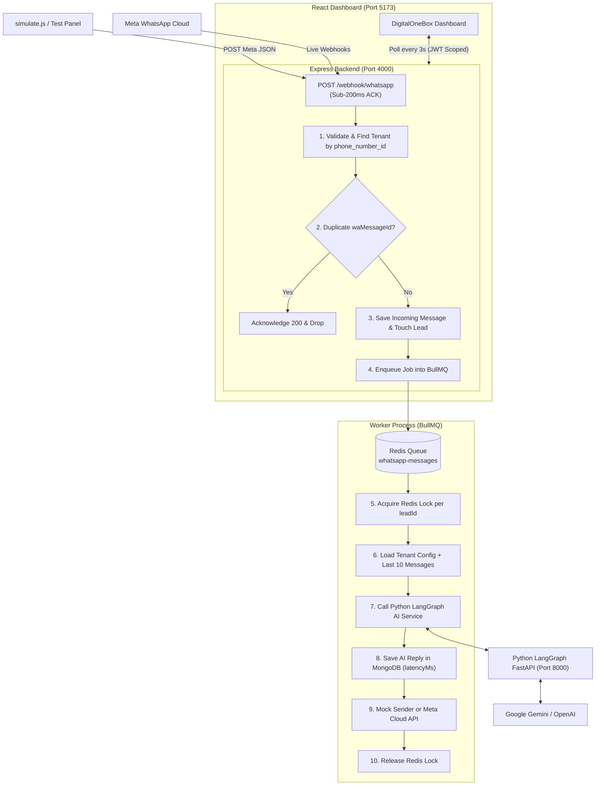

# 🚀 DigitalOneBox — Multi-Tenant WhatsApp AI Sales Agent

An enterprise-grade, multi-tenant WhatsApp AI Sales Agent platform built with **Node.js, Express, MongoDB, BullMQ, Redis, React (Vite)**, and **LangGraph (Python)**.

Powered by **[DigitalOneBox](https://digitalonebox.com/)** — Global AI & Enterprise Software Development.

---

## 📋 Table of Contents
1. [Core Features](#-core-features)
2. [Architecture Overview](#-architecture-overview)
3. [Login Credentials](#-login-credentials)
4. [Prerequisites](#-prerequisites)
5. [Environment Setup](#-environment-setup)
6. [Step-by-Step: How to Start](#-step-by-step-how-to-start)
7. [Running Automated Simulation Tests](#-running-automated-simulation-tests)
8. [Dashboard Walkthrough & Manual Verification](#-dashboard-walkthrough--manual-verification)
9. [Connecting a Real WhatsApp Number (Meta Cloud API Sandbox)](#-connecting-a-real-whatsapp-number-meta-cloud-api-sandbox)
10. [Folder Structure](#-folder-structure)
11. [Production Scaling (10,000+ Leads)](#-production-scaling-10000-leads)

---

## ✨ Core Features

### 🏢 1. True Multi-Tenancy & Data Isolation
- **Strict Tenant Boundaries:** Zero cross-tenant data leakage. Every database query, message history lookup, and dashboard API is scoped by `accountId`.
- **Automatic Tenant Resolution:** Webhooks resolve tenant purely by incoming `metadata.phone_number_id`; dashboard sessions derive `accountId` exclusively from signed JWT cookies (never from user input, query params, or URL).
- **Cross-Tenant Security:** If Tenant A attempts to access a lead belonging to Tenant B (`GET /api/leads/:leadId/messages`), the server returns `404 Not Found` (never revealing the other tenant's data).

### ⚡ 2. High-Performance Webhook & Queue Pipeline
- **Sub-200ms Webhook:** `POST /webhook/whatsapp` immediately returns `200 OK` to Meta in single-digit milliseconds, enqueuing message jobs into **BullMQ**.
- **Per-Lead Sequential Locking:** Messages from the **same lead** are processed strictly in chronological order using Redis distributed locks (`lock:lead:<leadId>`).
- **Parallel Processing Across Leads:** Messages from **different leads** process concurrently across worker pools.
- **Idempotency & Deduplication:** Database-level unique index on `waMessageId` guarantees that duplicate webhooks (re-sent by Meta on network drops) are processed exactly once.

### 🧠 3. LangGraph Autonomous AI Agent (Python)
- **FastAPI + LangGraph Architecture:** Built as a standalone Python microservice using a compiled 5-node `StateGraph`:
  `validate_input ➔ load_tenant_context ➔ build_prompt ➔ call_llm ➔ validate_response`.
- **Dynamic Tenant Context:** The prompt is populated strictly with the requesting tenant's business name, tone, language policy, pricing, and FAQs.
- **10-Message Conversation Memory:** Automatically retains the last 10 messages of the lead for natural multi-turn context (e.g. recalling customer names, preferences, and visit requests).
- **Multilingual Support:** Naturally understands and responds in **English, Hindi, or Hinglish** based on how the customer speaks.
- **Fault-Tolerant Retries & Fallback:** Uses `tenacity` exponential backoff (up to 3 retries). If the LLM is unavailable or times out, a polite fallback message is saved with `sender: "fallback"`.

### 🖥️ 4. Enterprise DigitalOneBox Dashboard (React + Vite)
- **Branded Showcase Login Page:** Dual-column enterprise UI featuring **[DigitalOneBox](https://digitalonebox.com/)** branding, ambient cyber lighting, 3D box logo, and 1-click evaluation demo tenant logins.
- **Live Leads List:** Real-time list of all leads for the logged-in tenant with name, phone, message preview, and relative timestamps (`2s ago`, `1m ago`).
- **Interactive Chat Console:** Left-aligned customer messages and right-aligned AI responses with sender badges (`AI`, `Fallback`, `Human`) and response latency tags (`replied in 1.8s`).
- **Human Takeover Switch (AI ON/OFF):** Toggle AI responses with one click (`PATCH /api/leads/:leadId/takeover`). When paused, the UI alerts with a prominent banner: *"AI paused: human is handling this chat"*.
- **Customer Simulator Test Panel:** Docked bottom bar to test sending messages as any customer directly through the Meta webhook (`POST /api/dev/simulate-message`).
- **Silent 3-Second Live Polling:** Seamlessly updates leads and conversation history without page reloads or UI flicker.
- **Session Persistence:** Protected routes authenticated via secure httpOnly JWT cookies (`GET /api/auth/me`).

### 🔄 5. Dual WhatsApp Modes
- **`mock` Mode (Default for Local Testing):** Saves outgoing messages into MongoDB `SentMessage` and streams to the dashboard, requiring no phone or Meta account.
- **`real` Mode (Meta Cloud API):** Native integration with Meta WhatsApp Business Cloud API with `GET /webhook/whatsapp` challenge verification and live Graph API messaging.

---

## 🏗️ Architecture Overview



---

## 🔑 Login Credentials

The database seed script provides two fully-configured tenants:

| Business Name | Email | Password | Phone Number ID | Account ID |
|---|---|---|---|---|
| **Sunrise Realty** | `owner@sunrise.test` | `Sunrise@123` | `PHONE_TENANT_A` | `acc_A` |
| **FitZone Gym** | `owner@fitzone.test` | `FitZone@123` | `PHONE_TENANT_B` | `acc_B` |

*(All passwords are cryptographically hashed with `bcrypt` 12 rounds before storage).*

---

## 📦 Prerequisites

Ensure the following runtimes and services are installed on your machine:

- **Node.js:** v18.0.0 or higher
- **npm:** v9.0.0 or higher
- **Python:** v3.10.0 or higher
- **MongoDB:** v6.0 or higher (running on port `27017`)
- **Redis:** v7.0 or higher (running on port `6379`)

---

## ⚙️ Environment Setup

### 1. Backend Configuration (`backend/.env`)
Copy `backend/.env.example` to `backend/.env`:
```env
NODE_ENV=development
PORT=4000

# MongoDB
MONGODB_URI=mongodb://localhost:27017/whatsapp_ai_agent

# Redis
REDIS_HOST=localhost
REDIS_PORT=6379
REDIS_PASSWORD=

# JWT
JWT_SECRET=digitalonebox_super_secret_jwt_key_2026
JWT_EXPIRES_IN=7d

# AI Service
AI_SERVICE_URL=http://localhost:8000
AI_TIMEOUT_MS=25000

# WhatsApp Mode: 'mock' (local testing) or 'real' (live Meta Cloud API)
WHATSAPP_MODE=mock
WHATSAPP_TOKEN=
WHATSAPP_VERIFY_TOKEN=digitalonebox_verify_token

# Worker
WORKER_CONCURRENCY=20
JOB_ATTEMPTS=3
JOB_BACKOFF_DELAY=2000

# Simulation Webhook URL
WEBHOOK_URL=http://localhost:4000/webhook/whatsapp
```

### 2. AI Service Configuration (`ai-service/.env`)
Copy `ai-service/.env.example` to `ai-service/.env`:
```env
PORT=8000

# LLM Provider: 'gemini' (recommended) or 'openai'
LLM_PROVIDER=gemini
GOOGLE_API_KEY=your_actual_google_gemini_api_key_here
GEMINI_MODEL=gemini-1.5-flash

# Alternative: OpenAI
# LLM_PROVIDER=openai
# OPENAI_API_KEY=sk-your_openai_key_here
# OPENAI_MODEL=gpt-4o-mini

# Reliability Settings
LLM_TIMEOUT_SECONDS=20
LLM_MAX_RETRIES=3
LLM_RETRY_WAIT_SECONDS=2
LOG_LEVEL=INFO
```

### 3. Frontend Configuration (`frontend/.env`)
```env
VITE_API_URL=http://localhost:4000
```

---

## 🚀 Step-by-Step: How to Start

### Step 1: Start MongoDB and Redis
If using Docker:
```bash
docker compose up -d
```
Or ensure native Windows/Linux services are running on ports `27017` and `6379`.

---

### Step 2: Install Dependencies
Open your terminal in the project root:

```bash
# 1. Install Backend Dependencies
cd backend
npm install

# 2. Install AI Service Dependencies
cd ../ai-service
pip install -r requirements.txt

# 3. Install Frontend Dependencies
cd ../frontend
npm install
cd ..
```

---

### Step 3: Seed Database
Seed the 2 tenants (Sunrise Realty & FitZone Gym) and their login credentials:
```bash
npm run seed
```
*(Idempotent: running multiple times updates records without duplicating).*

---

### Step 4: Run the Application Services

Open 3 separate terminal tabs or windows:

#### Terminal 1: Python LangGraph AI Service
```bash
cd ai-service
uvicorn app.main:app --port 8000 --reload
```
*Health check:* Visit `http://localhost:8000/health` (should return `{"status":"ok"}`).

#### Terminal 2: Node.js Backend Server & Queue Worker
```bash
cd backend
npm run dev
```
*(Starts Express server on port `4000` and starts the BullMQ worker in the same process).*

> **Tip:** If you wish to run the worker in a dedicated standalone process, run `npm run dev` in one terminal and `npm run worker` in another.

#### Terminal 3: React Dashboard Frontend
```bash
cd frontend
npm run dev
```
Open **`http://localhost:5173`** in your browser.

---

## 🧪 Running Automated Simulation Tests

With the backend and AI service running, execute the end-to-end simulation suite:

```bash
npm run simulate
```

### What It Tests:
1. **Test 1 — Concurrency (20 Simultaneous Leads):** Sends 20 messages simultaneously (10 for Sunrise Realty + 10 for FitZone Gym). Asserts that all 20 receive exactly 1 reply and webhooks respond in `< 200ms`.
2. **Test 2 — Duplicate Message Idempotency:** Sends the identical payload 3 times rapidly. Asserts that exactly 1 reply is generated.
3. **Test 3 — Sequential Ordering & Conversational Memory:** Sends 3 sequential messages from one lead (`"Hi"` ➔ `"Mera naam Amit hai"` ➔ `"Mera naam kya hai?"`). Asserts strict reply order and that the AI remembers the name **Amit**.
4. **Test 4 — Tenant Isolation & Prompt Defense:** Sends an adversarial prompt to FitZone Gym attempting to extract Sunrise Realty's 2BHK prices. Asserts that no competitor data leaks.

### Sample Expected Output:
```text
==================== SIMULATION REPORT ====================
Test 1 - Concurrency (20 leads)
  Replies received      : 20 / 20        PASS
  Webhook max response  : 42 ms          PASS
  Avg time to reply     : 3.10 s
  Slowest time to reply : 6.40 s

Test 2 - Duplicate message (sent 3x)
  Replies for wamid.dup... : 1           PASS

Test 3 - Order + memory
  Replies in order      : yes            PASS
  Remembered name Amit  : yes            PASS
  Last reply preview    : "Aapka naam Amit hai! Main FitZone Gym..."

Test 4 - Tenant isolation
  Leaked Tenant A data  : no             PASS
  Reply preview         : "Main sirf FitZone Gym ke plans ke baare mein..."
===========================================================
Overall: ALL TESTS PASSED
```

---

## 🖥️ Dashboard Walkthrough & Manual Verification

Follow these steps to demonstrate the full multi-tenant system in the browser:

1. **Open the Dashboard:** Go to `http://localhost:5173`. You will see the **DigitalOneBox** branded login portal.
2. **Login as Sunrise Realty:** Click the **Sunrise Realty** demo button (or enter `owner@sunrise.test` / `Sunrise@123`).
3. **Verify Tenant A Scope:**
   - Header shows **Sunrise Realty**.
   - Leads list displays only Sunrise Realty leads.
   - Click any lead to inspect the chat history. Note the latency tag (`replied in X.Xs`) and sender badge (`🤖 AI`).
4. **Send a Live Simulated Message:**
   - In the bottom test panel, enter a new phone number (e.g. `919811122233`), Name: `Pooja Sharma`, Message: `2BHK flat ka price kya hai?`.
   - Click **Send**.
   - Within 3 seconds, the new lead appears in the sidebar, and the AI reply appears in the chat without refreshing the page!
5. **Test Human Takeover:**
   - In the chat header, click **AI: ON ●**. It switches to **AI: OFF ○**.
   - A warning banner appears: `⚠️ AI paused: human is handling this chat`.
   - Send another test message from the test panel. The message appears, but the AI does not reply.
   - Click **AI: OFF ○** to re-enable AI.
6. **Verify Cross-Tenant Isolation:**
   - Log out and log in as **FitZone Gym** (`owner@fitzone.test` / `FitZone@123`).
   - Header displays **FitZone Gym**.
   - Leads list shows exclusively FitZone gym leads (memberships, workout timings). **No Sunrise Realty leads appear.**
   - Open browser developer tools and attempt `GET /api/leads/<SunriseLeadId>/messages`. The server returns **404 Not Found**.

---

## 📱 Connecting a Real WhatsApp Number (Meta Cloud API Sandbox)

To chat with your AI agent live from your personal WhatsApp mobile app:

1. **Create Free Meta App:** Go to [developers.facebook.com](https://developers.facebook.com/) ➔ Create App ➔ Select **Business** ➔ Set up **WhatsApp**.
2. **Copy Credentials:** Meta provides a **Temporary Access Token**, **Phone Number ID**, and a **Test Phone Number**.
3. **Add Your Personal Phone:** On the Meta setup page, add your mobile number to the test recipient list and verify the OTP.
4. **Expose Local Server with ngrok:**
   ```bash
   npx ngrok http 4000
   ```
   Copy the HTTPS forwarding URL (e.g. `https://xyz123.ngrok-free.app`).
5. **Configure Webhook in Meta:**
   - **Callback URL:** `https://xyz123.ngrok-free.app/webhook/whatsapp`
   - **Verify Token:** `digitalonebox_verify_token`
   - Click **Verify and Save**, then subscribe to the **`messages`** webhook field.
6. **Update Backend `.env`:**
   ```env
   WHATSAPP_MODE=real
   WHATSAPP_TOKEN=EAAG...YourMetaToken...
   WHATSAPP_VERIFY_TOKEN=digitalonebox_verify_token
   ```
7. **Link Phone Number ID to Tenant A:**
   ```bash
   node -e "const mongoose = require('mongoose'); mongoose.connect('mongodb://localhost:27017/whatsapp_ai_agent').then(async () => { await mongoose.model('Tenant', new mongoose.Schema({}, {strict: false})).updateOne({ accountId: 'acc_A' }, { phoneNumberId: 'YOUR_META_PHONE_NUMBER_ID' }); console.log('Tenant linked to Meta Phone Number ID!'); process.exit(0); });"
   ```
8. **Message from WhatsApp:** Send `"Hi, flat prices kya hai?"` from your phone to the Meta Test Number. The AI will reply to your WhatsApp within seconds!

---

## 📁 Folder Structure

```
digitalonebox/
├── docker-compose.yml              # MongoDB & Redis containers
├── package.json                    # Root scripts (seed, dev, simulate)
├── README.md                       # Comprehensive documentation
├── ai-service/                     # Python LangGraph Microservice
│   ├── requirements.txt            # FastAPI, LangGraph, LangChain, Tenacity
│   ├── .env.example
│   └── app/
│       ├── main.py                 # FastAPI endpoints (/health, /agent/reply)
│       ├── config/settings.py      # Pydantic settings & validation
│       ├── graph/                  # LangGraph StateGraph & Node Pipeline
│       │   ├── graph.py            # Graph definition & compilation
│       │   ├── nodes.py            # Input validation, context, LLM, retry
│       │   └── state.py            # AgentState schema
│       └── prompts/builder.py      # Tenant prompt & message constructor
├── backend/                        # Node.js + Express Backend
│   ├── package.json
│   ├── .env.example
│   ├── scripts/
│   │   ├── seed.js                 # Seeds tenants & bcrypt owner credentials
│   │   ├── simulate.js             # End-to-end 4-test simulation suite
│   │   └── sample-payload.json     # Meta-format sample payload
│   └── src/
│       ├── server.js               # Server bootstrap & graceful shutdown
│       ├── app.js                  # Express app, middleware, routes, CORS
│       ├── config/                 # Database, Redis, Winston logger, Env config
│       ├── middlewares/            # JWT auth middleware, error handlers
│       ├── models/                 # Mongoose models (Tenant, User, Lead, Message, SentMessage)
│       ├── queue/                  # BullMQ queue & worker with Redis locking
│       ├── repositories/           # Scoped database access layers
│       ├── routes/                 # Webhook, Auth, Leads, Dev simulate routes
│       └── services/               # AI client service, Mock/Meta WhatsApp sender
└── frontend/                       # React (Vite) Enterprise Dashboard
    ├── package.json
    ├── vite.config.js              # Dev proxy to backend port 4000
    ├── index.html                  # DigitalOneBox branding & meta tags
    └── src/
        ├── App.jsx                 # Auth gate & session router
        ├── api/client.js           # Standardized API client (credentials: include)
        ├── styles/dashboard.css    # Full SaaS design system & DigitalOneBox theme
        └── components/
            ├── Login.jsx           # Dual-column DigitalOneBox login page
            ├── Dashboard.jsx       # Main layout & 3s polling orchestrator
            ├── Header.jsx          # Tenant badge, user email, logout
            ├── LeadList.jsx        # Searchable leads sidebar with badges
            ├── LeadListItem.jsx    # Individual lead cards with time-ago preview
            ├── ChatWindow.jsx      # Conversation viewport & takeover banner
            ├── MessageBubble.jsx   # WhatsApp bubbles with latency & sender badges
            ├── TakeoverToggle.jsx  # AI ON/OFF interactive switch
            └── TestMessagePanel.jsx# Customer simulator bottom panel
```

---

## ⚡ Production Scaling (10,000+ Leads)

To scale this platform to 10,000+ simultaneous leads in high-traffic enterprise environments:

1. **Distributed Queue Sharding:** Partition BullMQ across a Redis Cluster using tenant-based queue shards to prevent one high-volume tenant from starving others.
2. **Stateless Worker Autoscaling:** Containerize the Node.js BullMQ workers and scale horizontally on Kubernetes (KEDA) based on queue lag metrics.
3. **Dedicated LangGraph AI Pods:** Scale the Python FastAPI service behind an Application Load Balancer with connection pooling and GPU/CPU inference nodes.
4. **Token Bucket Rate Limiting:** Implement per-tenant rate limiters to buffer bursts against LLM provider quotas (e.g. OpenAI / Google Gemini TPM/RPM limits).
5. **MongoDB Read Replicas:** Route dashboard read queries (`GET /api/leads`, `GET /api/leads/:leadId/messages`) to secondary read replicas with indexing on `{ accountId: 1, lastMessageAt: -1 }`.
6. **Webhook Signature Verification:** Verify the `X-Hub-Signature-256` HMAC-SHA256 header using the Meta App Secret for enterprise webhook security.

---

## 📄 License
MIT License. Built for the Agentic AI Developer Assignment by **[DigitalOneBox](https://digitalonebox.com/)**.
