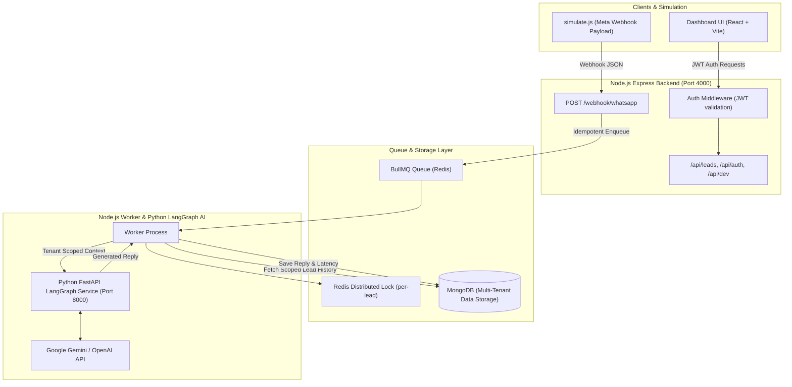
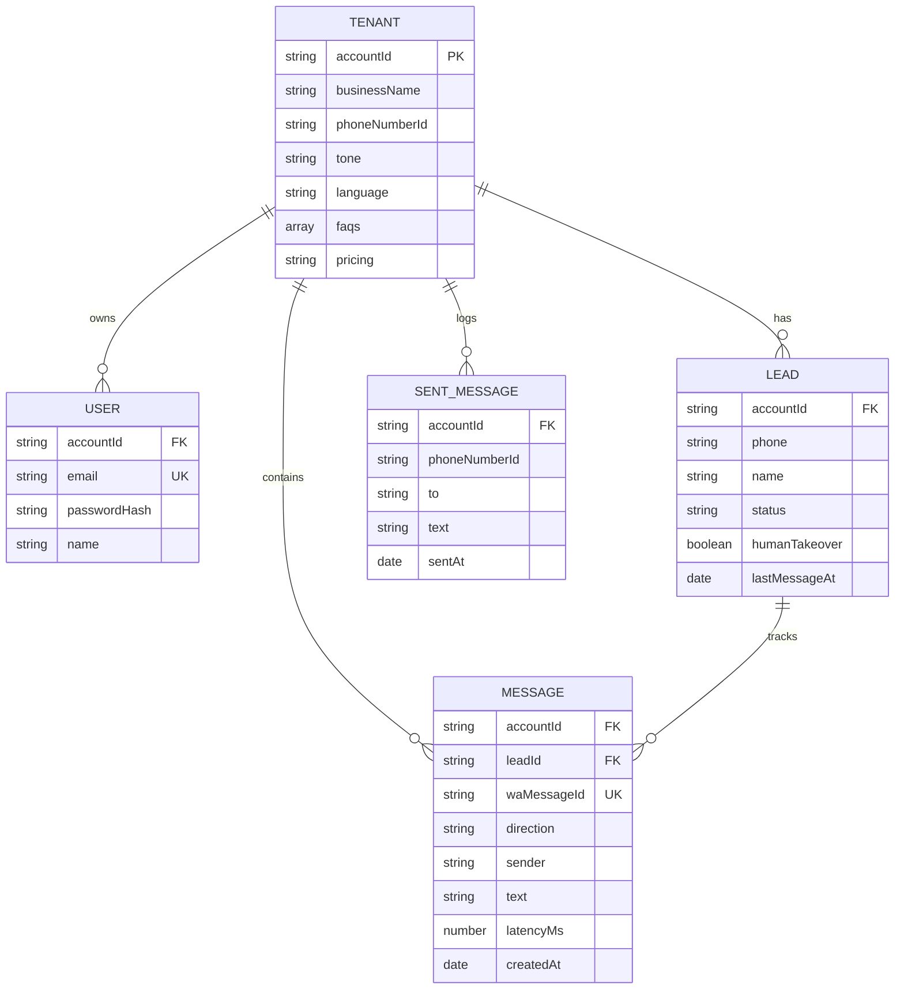

# Multi-Tenant WhatsApp AI Sales Agent Architecture

## System Overview

The Multi-Tenant WhatsApp AI Sales Agent is an enterprise-grade platform designed to serve multiple distinct business tenants simultaneously over WhatsApp. The platform decouples message ingestion, queueing, AI processing (via LangGraph in Python), and tenant dashboard presentation into a highly scalable, isolated multi-tenant architecture.

---

## Key Architectural Principles

### 1. Zero Cross-Tenant Data Leakage
- **Webhook Tenant Resolution:** Webhooks derive tenant identity strictly from `metadata.phone_number_id` in the Meta payload.
- **API Request Scoping:** All `/api/*` routes derive `accountId` exclusively from the verified JWT payload (`req.accountId`). Client-supplied body or URL query parameters can never override tenant identity.
- **Isolated AI Prompts:** The Python LangGraph service receives *only* the specific tenant's context (FAQs, tone, pricing) and conversation memory for that specific lead. Prompt construction dynamically injects tenant rules while isolating all other tenants.

### 2. Fast Webhook Response (< 200 ms) & Asynchronous Queue
- Webhook calls are processed immediately:
  1. Resolve Tenant by `phoneNumberId`.
  2. Deduplicate message using unique index on `waMessageId`.
  3. Find/Create Lead by `(accountId, phone)`.
  4. Save incoming message.
  5. Enqueue job into BullMQ.
  6. Return `200 OK` instantly (< 50ms).
- Long-running LLM invocation occurs asynchronously inside the BullMQ Worker.

### 3. Per-Lead Order Preservation with Parallel Cross-Lead Execution
- Messages from the same lead are locked using a Redis key (`lock:lead:<leadId>`).
- If a message for a lead is currently being processed, subsequent messages for that lead wait for the lock release.
- Messages for different leads execute concurrently across worker threads.

### 4. LangGraph AI Execution Pipeline
The Python AI service processes incoming requests through a compiled 5-step LangGraph graph:
1. `validate_input`: Verifies payload format and required fields.
2. `load_tenant_context`: Ingests business FAQs, pricing, tone, and language.
3. `build_prompt`: Formats system prompt and historical context window (last 10 messages).
4. `call_llm`: Executes LLM query with exponential backoff retries (tenacity).
5. `validate_response`: Validates reply quality and truncates for WhatsApp constraints if necessary.

---

## Data Models & Relations

---

## Security Boundaries & Compliance

- **Password Hashing:** Passwords are stored exclusively using bcrypt with salt rounds = 10.
- **Idempotency:** `waMessageId` has a MongoDB unique index preventing duplicate message processing even under high-velocity payload replays.
- **Cross-Tenant Guardrails:** Attempting to query or manipulate a lead ID belonging to another tenant returns an HTTP `404 Not Found`, ensuring tenant resource non-existence privacy.
